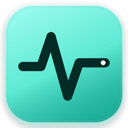
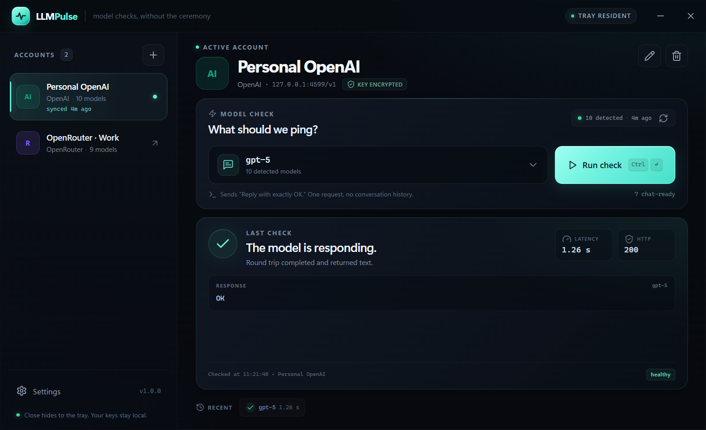
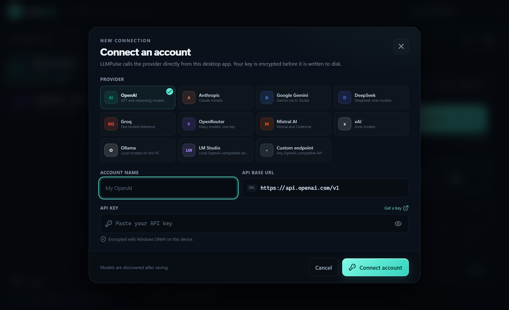
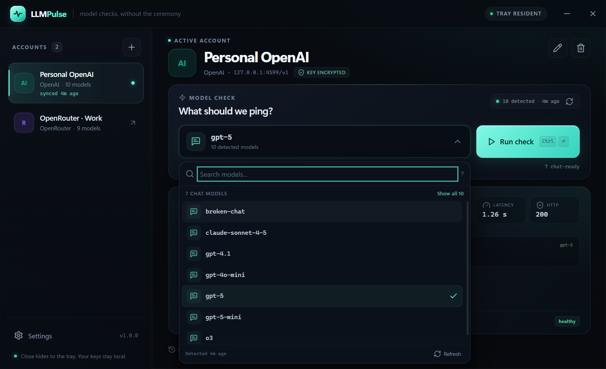
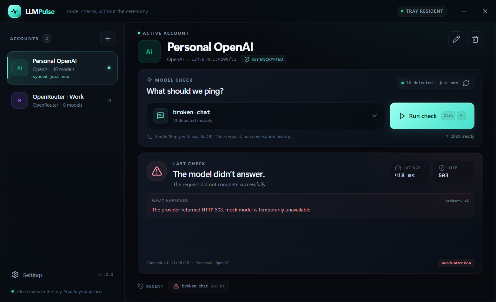
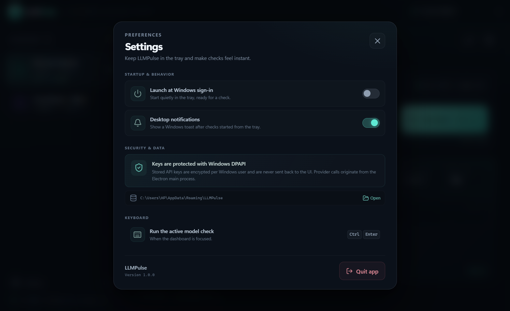

<div align="center">
  
  <h1>LLMPulse</h1>
  <p><strong>A tray-first Windows app for checking whether an LLM model is actually responding.</strong></p>
  <p>
    
    
    
    
  </p>
</div>

---

LLMPulse lives in the Windows notification area. Click the tray icon, pick one of your provider accounts, and it discovers the models that account can access. Choose a model, run a tiny prompt, and get the real latency, HTTP status, and response text back in seconds. Close the window and it slips back into the tray.



## Why it exists

Checking an LLM is usually a five-step detour through a terminal, a `.env` file, and a provider dashboard. LLMPulse collapses that into two clicks: **open tray → run check**.

- **One app, many accounts.** Keep personal, work, local, and gateway accounts side by side.
- **Models are detected for you.** LLMPulse uses each provider's native model-list API; no hand-maintained model names.
- **Know *how* it failed.** Authentication errors, bad base URLs, rate limits, timeouts, and model-specific failures are reported distinctly.
- **No hidden history.** A check is one request with one short prompt. Conversations are not stored.
- **Tray-friendly by design.** Closing the window hides it. The tray menu can run the active model check, show notifications, or start LLMPulse at sign-in.

## Screens

The screenshots below use the bundled mock server and demo accounts.

| Connect an account | Discovered models |
| --- | --- |
|  |  |

| A failed check is just as useful | Preferences |
| --- | --- |
|  |  |

## Supported providers

| Provider | Discovery | Check |
| --- | --- | --- |
| OpenAI | `GET /v1/models` | OpenAI chat completions |
| Anthropic | `GET /v1/models` | Anthropic Messages API |
| Google Gemini | `GET /v1beta/models` | `generateContent` |
| DeepSeek | OpenAI-compatible | OpenAI-compatible |
| Groq | OpenAI-compatible | OpenAI-compatible |
| OpenRouter | OpenAI-compatible | OpenAI-compatible |
| Mistral AI | OpenAI-compatible | OpenAI-compatible |
| xAI | OpenAI-compatible | OpenAI-compatible |
| Ollama | OpenAI-compatible (local) | OpenAI-compatible |
| LM Studio | OpenAI-compatible (local) | OpenAI-compatible |
| Custom endpoint | OpenAI-compatible `/models` | OpenAI-compatible |

OpenAI-compatible providers use the base URL you provide. Hosted URLs normally end in `/v1`; local servers usually look like `http://localhost:11434/v1` (Ollama) or `http://localhost:1234/v1` (LM Studio). API keys are optional for local providers.

## How a check works

1. **Discover:** `GET {baseUrl}/models` with the account's credentials. Anthropic and Gemini use their own model-list endpoints and pagination.
2. **Chat models first:** model lists often include embeddings, image, speech, and moderation models. Those stay available behind **Show all**, but chat-shaped models are sorted first.
3. **Check:** one non-streaming chat request with the prompt `"Reply with exactly OK and nothing else."` The default timeout is 45 seconds. No temperature, token limits, or other optional parameters are sent, which keeps compatibility high across providers.
4. **Report:** round-trip latency, HTTP status, the first text returned, and a clear error message when something goes wrong.

A check with a hosted provider consumes a very small number of tokens and may cost a fraction of a cent. LLMPulse does not run checks automatically on launch.

## Security model

- **Key storage:** API keys are encrypted with Electron `safeStorage` (Windows DPAPI) and written to `%APPDATA%\LLMPulse\llmpulse.json`. The encrypted file is bound to the current Windows user and cannot be decrypted by another account or machine.
- **Process boundary:** after an account is saved, keys are decrypted only inside the Electron main process to sign provider requests. They are never sent back to the renderer through IPC or exposed in the UI.
- **Locked-down renderer:** `contextIsolation: true`, `sandbox: true`, `nodeIntegration: false`, a strict Content Security Policy, blocked navigation, and denied permission requests.
- **No relay:** LLMPulse has no backend. Requests go directly from your PC to the URL configured for the account.
- **No telemetry:** nothing is collected or uploaded by the app.
- **Leak protection:** credentials are stripped from provider error text, and cross-origin redirects are rejected rather than forwarding authentication headers.
- **Removable:** editing an account can delete its saved key; removing an account deletes its key and cached model list.

The JSON store still contains account names, base URLs, and cached model names. Those are not secrets, but they are local data. Remove an account or delete `%APPDATA%\LLMPulse` to clear everything.

## Getting started

**Requirements:** Windows 10/11, Node.js 22.12 or newer, npm 10 or newer. Network access is needed once to install Electron and build tooling.

```powershell
npm install
npm run dev
```

`npm run dev` starts Vite and the Electron shell. The first run opens the onboarding window; after you have an account, launching the app starts quietly in the tray.

### Try it without a real API key

A mock OpenAI-compatible server is included:

```powershell
npm run mock
```

Then connect an **OpenAI** account in LLMPulse with:

- **Base URL:** `http://127.0.0.1:4599/v1`
- **API key:** any non-empty string

The mock exposes chat models (including one deliberately broken model) and non-chat models so the filtering UI can be exercised.

### Build a Windows installer

```powershell
npm run dist
```

The NSIS installer is written to `release/LLMPulse-Setup-1.0.0.exe`. It installs per-user by default, creates Start menu and desktop shortcuts, and does not require admin rights. `npm run dist:dir` produces an unpacked app in `release/win-unpacked/` for quick testing.

The generated installer is unsigned. Windows SmartScreen may warn until you sign it with an Authenticode code-signing certificate. To sign, configure `win.certificateFile`/`certificatePassword` or the `CSC_LINK`/`CSC_KEY_PASSWORD` environment variables for electron-builder.

### Tests

```powershell
npm run test:providers
```

This starts local HTTP fixtures and exercises OpenAI-compatible, Anthropic, and Gemini discovery/check flows, including API-key redaction. It does not need network access.

## Using the app

- **Open/close:** click the tray icon to toggle the window. The X button hides it; it keeps running in the tray.
- **Check the active model from the tray:** right-click the tray icon → **Check active model**. You get a Windows notification if the window is hidden and notifications are enabled.
- **Keyboard:** `Ctrl+Enter` runs the active check from the dashboard.
- **Account changes:** the pencil and trash icons next to the account name edit or remove it.
- **Model list:** search by model ID, switch between chat models and the full list, or refresh detection.
- **Startup:** Settings → **Launch at Windows sign-in**; the app starts hidden in the tray after an account exists.
- **Quit:** tray menu → **Quit LLMPulse**, or Settings → **Quit app**.

## Project structure

```text
LLMPulse/
├─ electron/
│  ├─ main.ts          # window, tray, IPC, notifications, quick checks
│  ├─ preload.ts       # narrow contextBridge API
│  ├─ providers.ts     # model discovery + check adapters and error handling
│  └─ store.ts         # validated JSON store + DPAPI key encryption
├─ shared/
│  ├─ presets.ts       # provider presets and base URLs
│  ├─ models.ts        # chat-model classification and sorting
│  └─ types.ts         # shared domain and IPC types
├─ src/
│  ├─ components/      # dashboard, model picker, result panel, modals
│  ├─ lib/             # IPC helpers and formatting
│  ├─ App.tsx          # application state and orchestration
│  └─ styles.css       # design system and layout
├─ scripts/
│  ├─ mock-llm-server.cjs
│  ├─ smoke-provider.cjs
│  ├─ run-electron.cjs
│  └─ generate_icons.py
├─ build/              # generated icon assets
└─ docs/               # screenshots
```

### Regenerate icons

The app icon and tray icon are generated from a small Pillow script:

```powershell
python -m pip install pillow numpy
python scripts/generate_icons.py
```

## Design notes

LLMPulse uses a warm, dark interface with a single mint accent. The pulse trace is used as a functional signal: idle is a flat trace, a running check animates, a successful response renders a clear heartbeat, and a failure gets the warning treatment. The model list deliberately separates chat models from embeddings and other assets, because "can I use this model?" usually means "can I talk to it?".

## Limitations

- Automatic discovery requires the account to expose a model-list endpoint. Azure OpenAI's deployment-based API and APIs without a `/models` route are not auto-discoverable; use an OpenAI-compatible gateway or extend `electron/providers.ts`.
- LLMPulse tests availability with a chat completion. It is not a benchmarking tool: latency includes network time and provider queueing.
- Only Windows is packaged today. The Electron code is otherwise portable, but the secure-storage copy and installer are Windows-specific.
- Checks are made one at a time; there is no batch-test-all action.

## License

[MIT](LICENSE)
